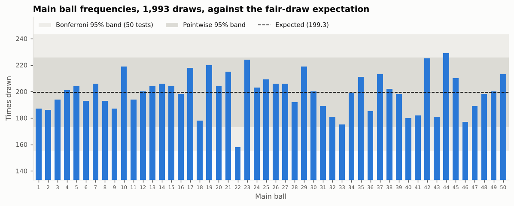
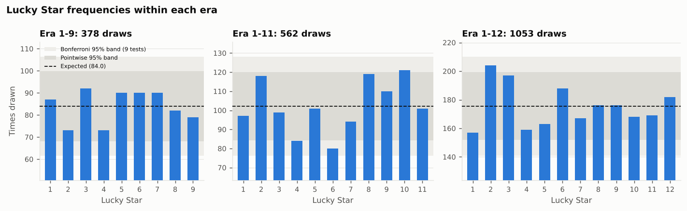
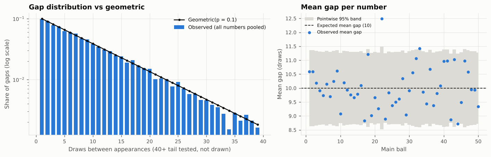
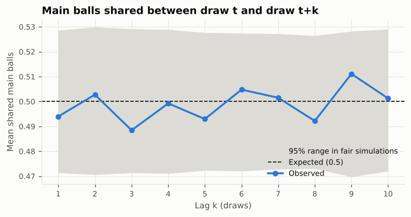
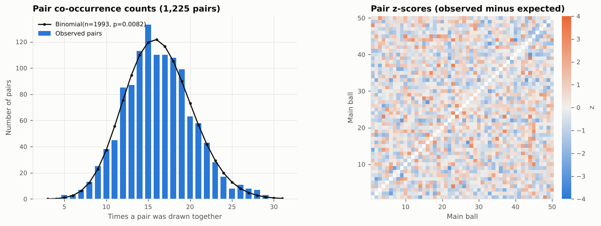
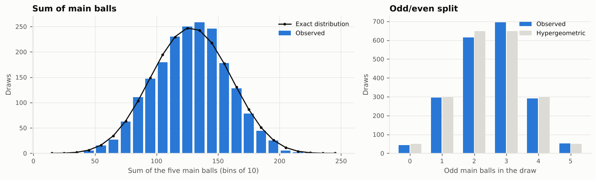
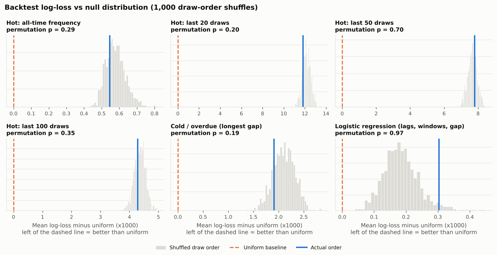
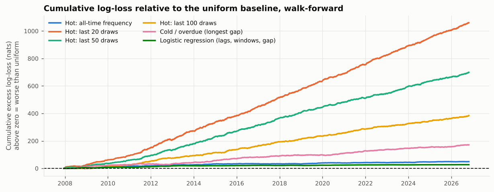
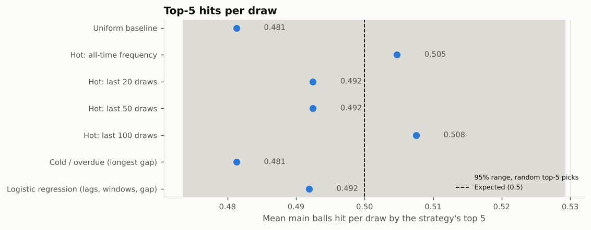
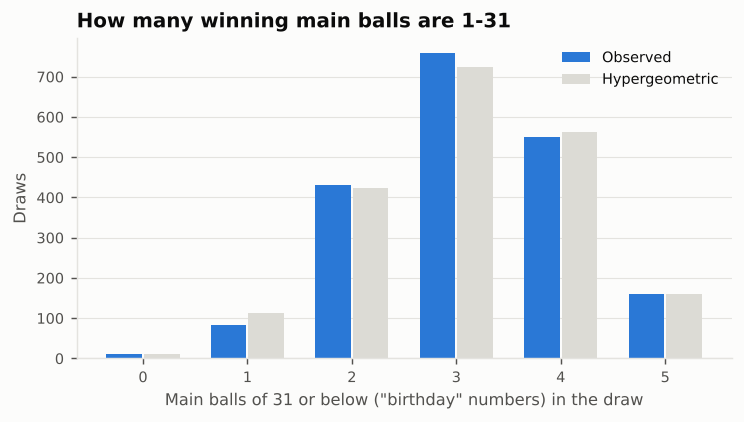

# EuroMillions: do past draws predict future draws?

_Data: 1,993 draws, 2004-02-13 to 2026-10-27. Generated by `python run_all.py`. Seed 20040213; 2,000 Monte Carlo histories; 1,000 draw-order permutations._

## Conclusion

No. Across 1,993 draws (2004-02-13 to 2026-10-27) the EuroMillions history is indistinguishable from a fair random draw: no main ball, Lucky Star, pair, gap pattern or lag relationship survives correction for multiple testing. The smallest p-value among the 14 global tests is 0.018 (Sum of main balls: standard deviation vs exact (two-sided)), which becomes 0.192 once you account for running 14 tests; that is what chance alone produces. The nearest miss among single numbers is ball 22, drawn 158 times against 199 expected (raw p = 0.002, 0.085 after correction); one number in 50 looking like that is ordinary. In the walk-forward backtest over 1,793 draws, no strategy (hot, hot-recent, overdue or logistic regression) beat the uniform 5/50 baseline. None of them even matched the uniform baseline's log-loss. The best was logistic regression (lags, windows, gap) at +0.304 millinats per number versus uniform (permutation p = 0.968). Top-5 picks hit 0.481–0.508 main balls per draw against 0.5 for random picks, all within chance. Past results carry no usable predictive signal. The only lever a player controls is not the odds but how many people they would share a jackpot with.

## Data

- **Primary source:** [daowa89/lottery-archive](https://github.com/daowa89/lottery-archive/blob/main/eu/euromillions/results.csv) `eu/euromillions/results.csv`, a GitHub-Actions-maintained archive that pulls from win2day.at (Österreichische Lotterien, an official EuroMillions operator). Full history, updated each draw day. Saved as `data/raw/lottery_archive_euromillions.csv` (1,987 rows as fetched).
- **Secondary source (cross-check):** result files bundled in the `pyeuromil==0.2.20211203` PyPI package, covering 2011-05-10 to 2021-12-03 (1,104 draws). Saved under `data/raw/pyeuromil/`.
- **Third source, for gaps outside the secondary's coverage only:** individual result pages on euro-millions.com (cited per row in `data/manual_corrections.csv`).
- Official operator sites (FDJ, National Lottery) were not reachable from the build environment, so they could not be used directly.

**Reconciliation.** Where both main sources cover the same date they agree on all 1,099 draws. The primary file has 12 problems, all listed below and in `data/processed/reconciliation_log.csv`. Nothing was resolved silently; a new unresolved conflict stops the build.

| Date in primary | Problem | Primary row | Secondary row | Resolution | Other evidence |
|---|---|---|---|---|---|
| 2009-03-26 | primary: off-schedule row (Thursday) | 8 16 18 37 43 \| 2 6 | – | re-dated to 2010-03-26 | https://www.euro-millions.com/results/26-03-2010 |
| 2010-07-04 | primary: off-schedule row (Sunday) | 12 13 36 41 46 \| 1 8 | – | re-dated to 2010-07-02 | https://www.euro-millions.com/results/02-07-2010 |
| 2012-12-16 | primary: off-schedule row (Sunday) | 3 7 12 13 25 \| 5 8 | – | re-dated to 2014-12-16 | pyeuromil 2014.txt (secondary source) |
| 2005-03-11 | primary: scheduled draw missing | – | – | added from other source | https://www.euro-millions.com/results/11-03-2005 |
| 2009-11-20 | primary: scheduled draw missing | – | – | added from other source | https://www.euro-millions.com/results/20-11-2009 |
| 2017-08-06 | primary: off-schedule row (Sunday) duplicates 2017-08-04 | 29 30 36 40 41 \| 2 9 | – | dropped as duplicate | – |
| 2012-09-12 | primary: off-schedule row (Wednesday) | 6 15 22 37 44 \| 2 4 | 2012-09-11: 6 15 22 37 44 \| 2 4 | re-dated to 2012-09-11 (secondary agrees) | – |
| 2014-01-03 | primary: scheduled draw missing | – | 3 27 31 38 44 \| 3 8 | added from secondary (single source) | – |
| 2014-10-21 | primary: scheduled draw missing | – | 20 21 27 33 40 \| 3 10 | added from secondary (single source) | – |
| 2014-10-24 | primary: scheduled draw missing | – | 3 9 20 30 42 \| 1 6 | added from secondary (single source) | – |
| 2015-01-02 | primary: scheduled draw missing | – | 22 24 25 28 49 \| 3 6 | added from secondary (single source) | – |
| 2016-01-01 | primary: scheduled draw missing | – | 4 37 38 39 44 \| 4 7 | added from secondary (single source) | – |

**Validation (all pass):** no duplicate dates or results; five distinct main balls in 1–50 and two distinct stars in range for every draw; every Friday from 13 Feb 2004 and every Tuesday from 10 May 2011 to 2026-10-27 is present, with no off-schedule draws. Main balls observed: 1–50.

**Lucky Star eras.** Tagged by date and confirmed against the data (`outputs/tables/star_value_first_seen.csv`):

| Era | Pool | First draw | Draws | Evidence in data |
|---|---|---|---|---|
| 1-9 | 9 | 13 Feb 2004 | 378 | no star above 9 before 10 May 2011 |
| 1-11 | 11 | 10 May 2011 (first Tuesday draw) | 562 | stars 10 and 11 first appear May–Jun 2011; no 12 before 27 Sep 2016 |
| 1-12 | 12 | 27 Sep 2016 | 1053 | star 12 first drawn on 27 Sep 2016 |

Star analyses are run within each era only.

## Analysis 1: is the history consistent with randomness?

Each global statistic is compared with its exact or asymptotic distribution where one exists, and always with 2,000 simulated fair histories of the same length. The frequency chi-square is corrected for drawing without replacement (the plain Pearson statistic understates variation by a factor (1−p)·N/(N−1)). The last column applies Benjamini-Hochberg across the whole family of global tests.

| Test | Statistic | df | p (analytic) | p (Monte Carlo) | p (BH, family) | Note |
|---|---|---|---|---|---|---|
| Main ball frequencies (chi-square, 49 df) | 58.17 | 49 | 0.174 | 0.166 | 0.344 |  |
| Main ball: most extreme single number (max \|z\|) | 3.08 | – | – | 0.102 | 0.327 | 2 of 50 nominally significant at 5%; 0 after BH/Bonferroni |
| Gap distribution, pooled vs geometric(0.1) (chi-square, 39 bins-1) | 33.72 | 39 | 0.709 | 0.679 | 0.864 | analytic p approximate: gaps are not independent across numbers |
| Gap distribution, worst single number (max chi-square) | 15.03 | – | – | 0.950 | 0.998 | 0 numbers significant after BH |
| Serial overlap, draws t and t+k, k=1..10 (max \|z\|) | 0.80 | – | – | 0.998 | 0.998 | lag-1 mean overlap 0.494 vs 0.500 expected |
| Per-number autocorrelation, 50 numbers x 10 lags (max \|z\|) | 3.71 | – | – | 0.117 | 0.327 | 22 of 500 nominally significant; 0 after BH |
| Pair co-occurrence dispersion, 1,225 pairs | 1263.05 | – | – | 0.196 | 0.344 | 63 pairs nominally significant (~61 expected by chance); 0 after BH |
| Pair co-occurrence, most extreme pair (max \|z\|) | 3.17 | – | – | 0.956 | 0.998 |  |
| Sum of main balls vs exact distribution (chi-square) | 154.08 | 131 | 0.082 | – | 0.327 | observed mean 127.57 vs 127.50; sd 29.81 vs 30.92 |
| Sum of main balls: standard deviation vs exact (two-sided) | 29.81 | – | – | 0.018 | 0.192 | observed sd 29.81 vs 30.92 expected |
| Odd-ball count per draw vs hypergeometric (chi-square) | 6.01 | 5 | 0.305 | – | 0.475 |  |
| Lucky Stars era 1-9 (378 draws) frequencies (chi-square, 8 df) | 6.15 | 8 | 0.630 | 0.637 | 0.864 |  |
| Lucky Stars era 1-11 (562 draws) frequencies (chi-square, 10 df) | 20.42 | 10 | 0.026 | 0.027 | 0.192 |  |
| Lucky Stars era 1-12 (1053 draws) frequencies (chi-square, 11 df) | 15.14 | 11 | 0.176 | 0.182 | 0.344 |  |



Bars outside the pale outer band would be significant after Bonferroni correction (and would be drawn in red); 0 are.

**Most extreme main balls (two-sided exact binomial):**

| Ball | Drawn | Expected | 95% CI (count) | p raw | p BH | p Bonferroni |
|---|---|---|---|---|---|---|
| 22 | 158 | 199.3 | 135–183 | 0.002 | 0.085 | 0.085 |
| 44 | 229 | 199.3 | 202–259 | 0.030 | 0.639 | 1.000 |
| 42 | 225 | 199.3 | 198–254 | 0.057 | 0.639 | 1.000 |
| 23 | 224 | 199.3 | 197–253 | 0.067 | 0.639 | 1.000 |
| 33 | 175 | 199.3 | 151–201 | 0.073 | 0.639 | 1.000 |
| 46 | 177 | 199.3 | 153–204 | 0.100 | 0.639 | 1.000 |



**Most extreme Lucky Stars (within era):**

| Era | Star | Drawn | Expected | p raw | p BH (within era) | p Bonferroni |
|---|---|---|---|---|---|---|
| 1-11 | 6 | 80 | 102.2 | 0.014 | 0.152 | 0.152 |
| 1-12 | 2 | 204 | 175.5 | 0.021 | 0.246 | 0.246 |
| 1-11 | 10 | 121 | 102.2 | 0.043 | 0.179 | 0.472 |
| 1-11 | 4 | 84 | 102.2 | 0.049 | 0.179 | 0.537 |
| 1-11 | 8 | 119 | 102.2 | 0.071 | 0.195 | 0.780 |
| 1-12 | 3 | 197 | 175.5 | 0.082 | 0.494 | 0.988 |



Gaps are measured in draws (1 = drawn again in the next draw). Under a fair draw they are geometric with p = 0.1 and mean 10. Per-number gap tests: 0 of 50 nominally significant, 0 after BH. Longest gap in the history: 88 draws (ball 16).



| Lag | Mean shared balls | z | p | p BH | p (full overlap distribution) |
|---|---|---|---|---|---|
| 1 | 0.494 | -0.42 | 0.676 | 0.958 | 0.697 |
| 2 | 0.503 | 0.19 | 0.848 | 0.958 | 0.685 |
| 3 | 0.488 | -0.80 | 0.423 | 0.958 | 0.470 |
| 4 | 0.499 | -0.05 | 0.958 | 0.958 | 0.817 |
| 5 | 0.493 | -0.49 | 0.625 | 0.958 | 0.847 |
| 6 | 0.505 | 0.33 | 0.740 | 0.958 | 0.119 |
| 7 | 0.502 | 0.10 | 0.917 | 0.958 | 0.057 |
| 8 | 0.492 | -0.54 | 0.588 | 0.958 | 0.754 |
| 9 | 0.511 | 0.77 | 0.442 | 0.958 | 0.151 |
| 10 | 0.501 | 0.09 | 0.930 | 0.958 | 0.820 |



Each of the 1,225 pairs should appear together in 0.816% of draws (16.3 times). 63 pairs are nominally significant at 5% (about 61 expected by chance); 0 survive BH and 0 survive Bonferroni.

**Most extreme pairs:**

| Pair | Together | Expected | p raw | p BH |
|---|---|---|---|---|
| 9–22 | 5 | 16.3 | 0.002 | 0.619 |
| 16–27 | 5 | 16.3 | 0.002 | 0.619 |
| 40–44 | 5 | 16.3 | 0.002 | 0.619 |
| 23–37 | 29 | 16.3 | 0.004 | 0.619 |
| 39–44 | 29 | 16.3 | 0.004 | 0.619 |



The sum distribution is computed exactly (all 2,118,760 combinations, by dynamic programming); the odd count is hypergeometric(50, 25, 5).

## Analysis 2: does any strategy beat random?

Walk-forward over draws 201 to 1993 (2007-12-14 onwards, 1,793 draws). At each draw every strategy sees only earlier draws and outputs a probability for each of the 50 main balls (summing to 5):

- **Uniform:** 0.1 for every ball.
- **Hot (all-time / last N):** frequency in the window, shrunk toward 0.1 by 10 pseudo-draws to avoid zero probabilities. Shrinkage only helps these strategies on log-loss; it does not change their top-5 picks.
- **Cold / overdue:** a linear tilt by current-gap rank; the most overdue ball gets roughly twice the probability of the most recent one.
- **Logistic regression:** features are appearance in each of the last 3 draws, frequency over the last 10/20/50/100 draws and all-time, and log current gap. Trained on every (draw, ball) row from draw 100 up to the current point and refitted every 100 draws.

Scores are mean per-ball log-loss and Brier score (lower is better) and mean main balls hit by each strategy's top 5. The permutation p-value shuffles draw order 1,000 times and reruns the full backtest, including refitting the model, then asks how often a shuffled history scores at least as well. The HAC p-value tests whether the per-draw log-loss is below uniform, using Newey-West errors. The exact hits p-value uses the fact that under a fair draw any past-only pick hits hypergeometric(50,5,5) balls per draw, whatever the strategy.

| Strategy | Log-loss | vs uniform (x1000) | Brier | p beats uniform (HAC) | p perm (log-loss) | p perm (Brier) | Top-5 hits/draw | p hits (exact) |
|---|---|---|---|---|---|---|---|---|
| Uniform baseline | 0.32508 | +0.000 | 0.09000 | – | – | – | 0.481 | 0.895 |
| Hot: all-time frequency | 0.32563 | +0.546 | 0.09010 | 1.000 | 0.294 | 0.249 | 0.505 | 0.383 |
| Hot: last 20 draws | 0.33691 | +11.825 | 0.09198 | 1.000 | 0.205 | 0.450 | 0.492 | 0.695 |
| Hot: last 50 draws | 0.33288 | +7.800 | 0.09126 | 1.000 | 0.704 | 0.640 | 0.492 | 0.695 |
| Hot: last 100 draws | 0.32937 | +4.285 | 0.09072 | 1.000 | 0.349 | 0.290 | 0.508 | 0.315 |
| Cold / overdue (longest gap) | 0.32699 | +1.911 | 0.09034 | 1.000 | 0.192 | 0.213 | 0.481 | 0.895 |
| Logistic regression (lags, windows, gap) | 0.32539 | +0.304 | 0.09005 | 1.000 | 0.968 | 0.964 | 0.492 | 0.708 |

Random top-5 picks on the same draws: mean 0.500 hits per draw (95% range 0.473–0.529). The uniform row's top 5 is a random tie-break, so it is one such random pick.







## Analysis 3: avoiding shared jackpots

Every combination has the same 1 in 139,838,160 chance. What differs is how many other players chose it, which decides how far a jackpot is split.



- 31 of the 50 main balls (62%) are possible days of the month. The draw itself does not care: winning draws contain 3.12 balls of 31 or below on average against 3.10 expected (chi-square p = 0.071), and all five were 31 or below in 160 draws (8.0%, against 8.0% expected).
- What is known about how people pick, from lottery studies that inferred popularity from published prize-tier winner counts on the UK National Lottery (Haigh 1997, J. R. Statist. Soc. A; and Ian Walker's analyses of UK Lotto winner data): people over-pick dates (1–31, and 1–12 especially), the number 7 and other 'lucky' numbers, geometric patterns on the play slip (rows, columns, diagonals), arithmetic runs (1-2-3-4-5, 5-10-15-20-25), and the previous draw's winning numbers. Numbers above 31 and irregular, unpatterned combinations are under-picked. These findings come from 6-from-49 lotto games, not EuroMillions; the same biases are widely assumed for EuroMillions but I have not verified EuroMillions-specific figures.
- **What public data can and can't tell you.** Operators do not publish how often each number or combination is chosen. They do publish, per draw, the number of winners in each prize tier (often per country) and sometimes sales. Comparing actual winners with the number expected from sales lets you estimate which drawn combinations were popular, which is how the studies above work. That data is not in this project's sources and the operator sites were not reachable from the build environment, so no popularity estimate is made here and none should be inferred from this report.
- **Practical upshot.** Avoiding sharing does not change your odds of winning, only your expected payout if you win. Lucky Dip (random selection) already avoids human bias. If you choose your own numbers, include several above 31, avoid patterns and runs, and avoid last week's winning numbers.

## Reproducing

```bash
pip install -r requirements.txt
python run_all.py            # fetch latest draws, rebuild, re-run everything, rewrite this report
python run_all.py --offline  # re-run on the raw files already in data/raw/
```

All tables behind this report are in `outputs/tables/`.
